<p align="center">
  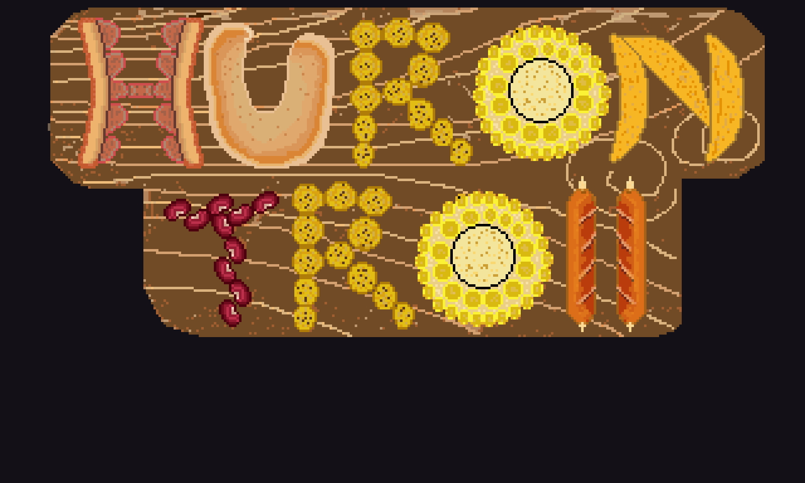
</p>

<h1 align="center">HuronTroll</h1>

<p align="center">
  <em>Plataformas 2D en pixel art, hecho en 48 horas para la Global Game Jam 2024.</em>
</p>

<p align="center">
  
  
  
  
  
</p>

---

## Índice

- [Qué es](#qué-es)
- [El tema: Make Me Laugh](#el-tema-make-me-laugh)
- [Cómo se juega](#cómo-se-juega)
- [Controles](#controles)
- [Mecánicas](#mecánicas)
  - [Movimiento y salto](#movimiento-y-salto)
  - [Agacharse](#agacharse)
  - [Recolección de items y llaves](#recolección-de-items-y-llaves)
  - [Puntuación persistente](#puntuación-persistente)
  - [Puertas de nivel](#puertas-de-nivel)
  - [La caca: la mecánica estrella](#la-caca-la-mecánica-estrella)
  - [Victoria y derrota](#victoria-y-derrota)
- [Niveles](#niveles)
- [Cinemática y storyboard](#cinemática-y-storyboard)
- [Arte y sonido](#arte-y-sonido)
- [Estructura del proyecto](#estructura-del-proyecto)
- [Cómo ejecutarlo](#cómo-ejecutarlo)
- [El proceso de la jam](#el-proceso-de-la-jam)
- [Lo que quedó fuera del build](#lo-que-quedó-fuera-del-build)
- [Equipo](#equipo)

---

## Qué es

**HuronTroll** es un juego de **plataformas 2D** en pixel art protagonizado por un hurón. Fue desarrollado en **48 horas** durante la **Global Game Jam 2024**, con el tema *"Make Me Laugh"*.

El juego está construido con **Unity 2022.3.4f1**, en **C#** y con física 2D. Todo el arte es pixel art original, y el tono es deliberadamente absurdo: los coleccionables son comida colombiana, la cinemática se cuenta sobre un tablero de corcho con memes, y el hurón puede hacer caca como habilidad.

<p align="center">
  <br>
  <sub>El logo: cada letra de «HURON» está formada con comida.</sub>
</p>

---

## Capturas

<p align="center">
  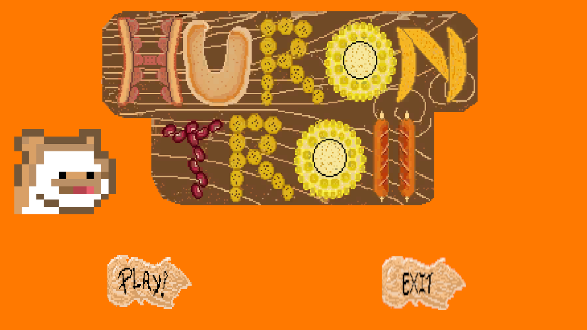<br>
  <sub>El menú principal, con los botones PLAY! y EXIT.</sub>
</p>

<table>
<tr>
<td width="50%">
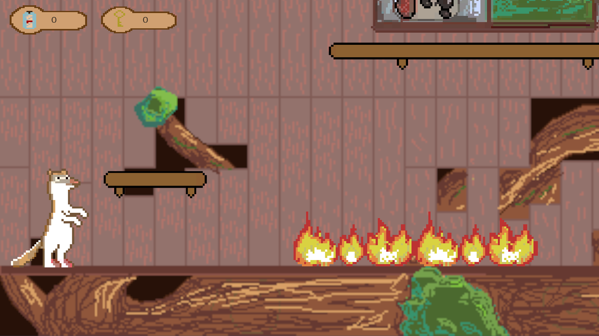<br>
<sub><b>Nivel 1</b> — plataformas, fuego como peligro y los contadores en pantalla.</sub>
</td>
<td width="50%">
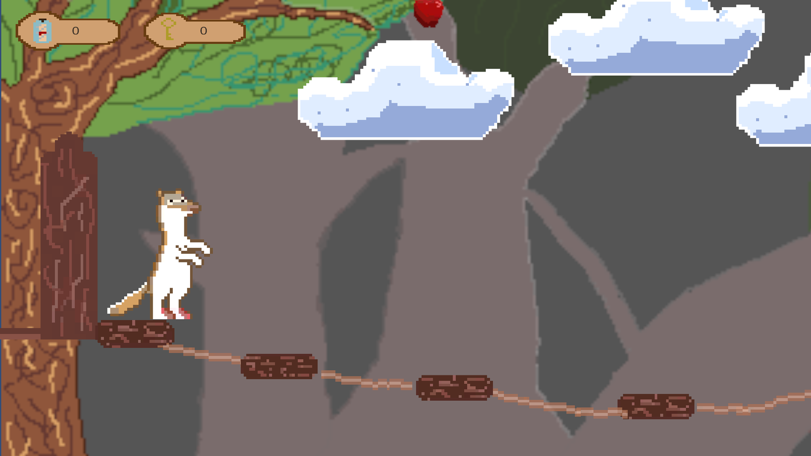<br>
<sub><b>Nivel 2</b> — el bosque, el puente de cuerdas y las nubes.</sub>
</td>
</tr>
</table>

<p align="center">
  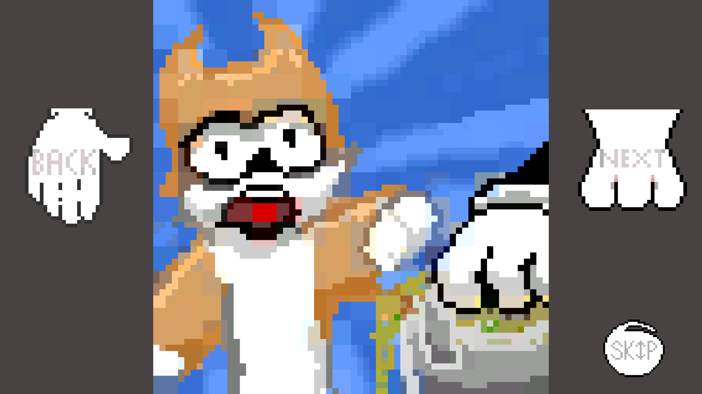<br>
  <sub>La cinemática, con los botones BACK, NEXT y SKIP.</sub>
</p>

---

## El tema: Make Me Laugh

La jam pedía hacer reír, y el equipo lo tomó al pie de la letra:

- **Doce memes reales** pinchados en un **tablero de corcho**, que hacen de cinemática narrativa.
- Los **coleccionables son platos colombianos**: arepa santanderiana, tamal santanderiano y hormiga culona.
- La habilidad principal es literalmente **hacer caca** con la tecla `Z`.
- Los archivos de audio tienen nombres como `que brutopongale cero.mp3`.

Es un juego de jam, y se nota —a propósito— en cada decisión.

---

## Cómo se juega

Es un plataformas de recorrido lateral. En cada nivel el hurón avanza saltando entre plataformas, esquiva pinchos y fuego, y recoge lo que encuentra.

Para **terminar un nivel** hace falta reunir **al menos una llave y al menos un item**; si no, la puerta de salida no se abre. La dificultad está en la precisión del salto y en no tocar los peligros, que devuelven al jugador al inicio con la pantalla de *Game Over*.

---

## Controles

| Acción | Tecla |
| --- | --- |
| Moverse | `←` `→` o `A` `D` |
| Saltar | `Espacio` |
| Agacharse | `↓` o `S` |
| Hacer caca | `Z` |
| Navegar la cinemática | Botones `Prev` / `Next` / `Skip` |
| Salir | `Esc` |

---

## Mecánicas

### Movimiento y salto

El control del hurón está en `PersonajeMovimiento.cs` y es el corazón del juego. Usa un **Rigidbody2D** con velocidad suavizada por `SmoothDamp`, para que el personaje arranque y frene con un poco de inercia en vez de moverse de golpe —un detalle que cambia por completo cómo se siente el control.

La detección de suelo se hace con un **`OverlapBox`** bajo los pies del personaje, y la de techo con un **`OverlapCircle`** sobre la cabeza. Ambas se dibujan en el editor con `OnDrawGizmos`, para poder ajustarlas de un vistazo sin entrar a jugar.

El giro del personaje se resuelve invirtiendo la escala en X, un truco clásico de 2D que evita duplicar sprites.

<p align="center">
  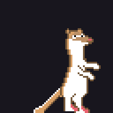
  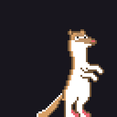
</p>

### Agacharse

Al mantener la tecla hacia abajo, el hurón se agacha: reduce la velocidad y **desactiva su colisionador alto**, lo que le permite pasar por huecos bajos. Si hay techo encima, el sistema fuerza el estado agachado para evitar que el personaje quede atascado dentro de la geometría.

<p align="center">
  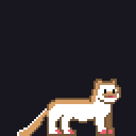
</p>

### Recolección de items y llaves

Cada coleccionable lleva una **etiqueta** (`Items` o `Llaves`). Cuando el jugador entra en su trigger, `itemsContactor.cs` suma los puntos correspondientes al marcador y destruye el objeto. Dos contadores distintos en pantalla, uno por cada tipo.

### Puntuación persistente

Este es el sistema más elaborado del proyecto y está en `ControladorPuntos.cs`.

Es un **Singleton con `DontDestroyOnLoad`**: el marcador sobrevive al cambio de escena, así que los items que recoges en el nivel 1 siguen contando en el nivel 2. Como la interfaz sí se destruye al cambiar de escena, el controlador se **resuscribe al evento `sceneLoaded`** y vuelve a buscar sus referencias de texto en la escena nueva.

Es un patrón que en un proyecto de 48 horas suele quedar mal resuelto, y aquí está bien planteado: sin duplicados, sin referencias rotas y sin perder el progreso.

### Puertas de nivel

`Teleport.cs` cierra el bucle del nivel: al tocar la puerta de salida, consulta el marcador global y **solo carga el siguiente nivel si hay al menos una llave y un item**. Si falta algo, avisa por consola en vez de dejar al jugador atascado sin explicación.

### La caca: la mecánica estrella

El chiste del juego, y también código de verdad:

- `makePoop.cs` — al pulsar `Z`, instancia un prefab en un punto de aparición.
- `poop.cs` — la caca se autodestruye pasados **5 segundos** con un `Invoke`, sin dejar basura en la escena.
- `ColliderFuegoPoop.cs` y `ColliderEliminarJugador.cs` — si el jugador toca fuego o un peligro, se reproduce la animación de **Muerte**, se congela el rigidbody y, tras 3,5 segundos, aparece la pantalla de Game Over.

### Victoria y derrota

- **Victoria** (`ColliderWin.cs`): al llegar a la meta, el jugador se detiene, se desactiva su script de movimiento y aparece el canvas de *Winner*, con botón para avanzar a los créditos.
- **Derrota**: pantalla de *Game Over* con opción de reiniciar el nivel actual.

---

## Niveles

El juego tiene **dos niveles** en el build final, más el menú, la cinemática y los créditos:

| Nivel | Ambientación |
| --- | --- |
| **Escena 1** | Primer nivel de plataformas, con los tiles base y los coleccionables |
| **escena 2** | Nivel de bosque, con cuerdas, puente y nubes |

<p align="center">
  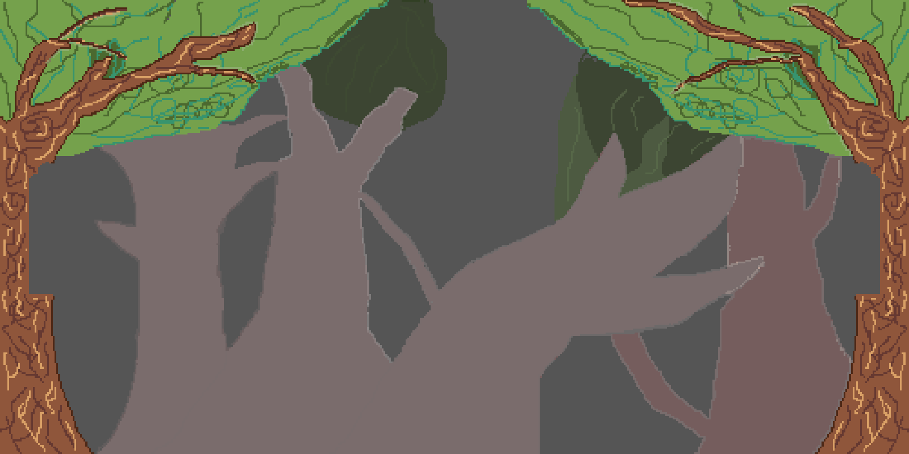<br>
  <sub>El fondo del nivel 2: un bosque oscuro con siluetas de árboles.</sub>
</p>

---

## Cinemática y storyboard

La cinemática no es un vídeo: es una **secuencia de cinco imágenes** sobre un tablero de corcho, con chinchetas rojas y memes. El jugador la pasa con los botones *Prev*, *Next* y *Skip*.

`storyboard.cs` gestiona un **array de imágenes** y muestra solo la activa según el índice, con navegación circular: al llegar a la última vuelve a la primera. El botón *Skip* salta directo al nivel 1.

Es la solución más rápida posible para contar una historia en una jam, y encaja perfecto con el tono del juego.

---

## Arte y sonido

Todo el arte es **pixel art original**, creado durante la jam. El hurón está animado como **hojas de sprites** con frames de 64 × 64: reposo, correr, salto, agachado, caída y muerte.

<p align="center">
  
  
  
  
  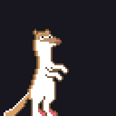
</p>

Los elementos del escenario también están animados: **fuego**, **chispas**, **manzana**, la **llave flotante**, una **nube que cae**, la **puerta que se cierra** y un **ratón en su trono**.

<p align="center">
  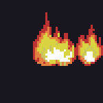
  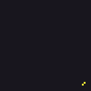
  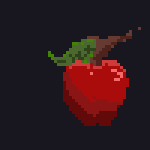
</p>

La **banda sonora** incluye música de fondo, de menú y de cinemática, además de efectos para botones, recoger items, abrir y cerrar puertas, llamas, aplausos y el sonido de muerte.

---

## Estructura del proyecto

```
HuronTroll/
├── Assets/
│   ├── Scenes/          Menu, storyboard, Escena 1, escena 2, Agradecimos
│   ├── Scripts/         15 scripts en C# (ver abajo)
│   ├── Animaciones/     Animators y clips del hurón y de los elementos
│   ├── pixelArt/        Sprites del personaje, elementos y escenarios
│   ├── Imagenes/        Logo, fondos, botones y los memes de la cinemática
│   ├── Audios/          Música y efectos
│   ├── Prefabs/         Prefab de la caca y de la tortuga
│   ├── Fisicas/         Material físico resbaladizo
│   └── Texturas/        Sprite del hurón
├── docs/img/            Imágenes y GIFs que usa este README
├── screenshots/         Capturas del juego
└── tools/make_gifs.py   Script que genera los GIFs desde las hojas de sprites
```

Los **15 scripts** están sin subcarpetas, porque en una jam se prioriza la velocidad: movimiento del personaje, controlador de puntos, coleccionables, tres tipos de colisión (muerte, victoria y activador de animación), teletransporte entre niveles, la mecánica de la caca, y los scripts de menú, storyboard y cambio de escena.

---

## Cómo ejecutarlo

**Con el ejecutable (recomendado):**

1. Descarga o compila la carpeta `Build/`.
2. Ejecuta **`HuronTroll.exe`**.
3. No necesita instalación; se ejecuta directamente.

**En el editor de Unity:**

1. Instala **Unity 2022.3.4f1** (LTS).
2. Abre la carpeta del proyecto con Unity Hub.
3. Abre la escena `Assets/Scenes/Menu.unity`.
4. Pulsa **Play**.

**Orden de escenas en el build:** `Menu` → `storyboard` → `Escena 1` → `escena 2` → `Agradecimos`.

El build se genera con `Build/HuronTroll.exe` como destino, para Windows de 64 bits. Es una compilación limpia, **sin errores ni advertencias**.

---

## El proceso de la jam

Los commits del repositorio cuentan las 48 horas mejor que cualquier resumen:

| Momento | Qué pasó |
| --- | --- |
| **26 de enero, 22:09** | `Initial commit` — arranca el proyecto la primera noche |
| **27 de enero, 03:42** | `Madrugada` — se sigue trabajando de madrugada |
| **27 de enero, 11:11** | `Medio dia` — la mañana siguiente |
| **27 de enero, 15:23** | `poop TimeLife` — nace la mecánica de la caca con su temporizador |
| **27 de enero, 15:58** | `poopCollide` — su colisión |
| **28 de enero, 06:28** | `push` — amanecer del tercer día |
| **28 de enero, 14:49** | `fff` — último commit, entrega |

Hay algo muy honesto en esos mensajes (`Shit`, `llll`, `fff`, `Madrugada`): son los commits reales de un equipo trabajando contra el reloj, sin tiempo para escribir mensajes bonitos. Y el resultado es un juego que se puede jugar de principio a fin.

**Reparto del trabajo** (según los archivos que tocó cada persona):

- **d3vsTech** llevó el grueso de la programación y los niveles: las escenas `Escena 1` y `Escenario 3`, los animators del ratón y los braseros, y la mecánica de la caca con sus colisiones.
- **Ar3nal3s** hizo la **cinemática completa**: la escena `storyboard`, su script, las cinco láminas (`n1`–`n5`) y la configuración del build, además de la escena 2.
- **Stephen León** se encargó de las **capturas** y del cierre.
- **Brayan Steven León Martínez** (este repositorio) dejó el README del proyecto.

---

## Lo que quedó fuera del build

Para ser exactos con el estado real del proyecto: existe una tercera escena de nivel, **`Assets/Scenes/Escenario 3.unity`**, con su propio arte (el ratón en el trono, los braseros rosa y negro, el cañón, y los coleccionables arepa, tamal y hormiga culona).

Esa escena **no está incluida en el Build Settings**, así que el nivel 3 no forma parte del juego jugable. Su arte sí se conserva en el repositorio.

---

## Equipo

Proyecto de la **Global Game Jam 2024**, tema *"Make Me Laugh"*.

| Integrante | Rol principal |
| --- | --- |
| **d3vsTech** | Programación y diseño de niveles |
| **Ar3nal3s** | Cinemática, storyboard y build |
| **Stephen León** | Capturas y cierre |
| **Brayan Steven León Martínez** | README y documentación del proyecto |

<br>

<p align="center"><sub>Hecho en 48 horas · Global Game Jam 2024 · Unity 2022.3.4f1 · C#</sub></p>
